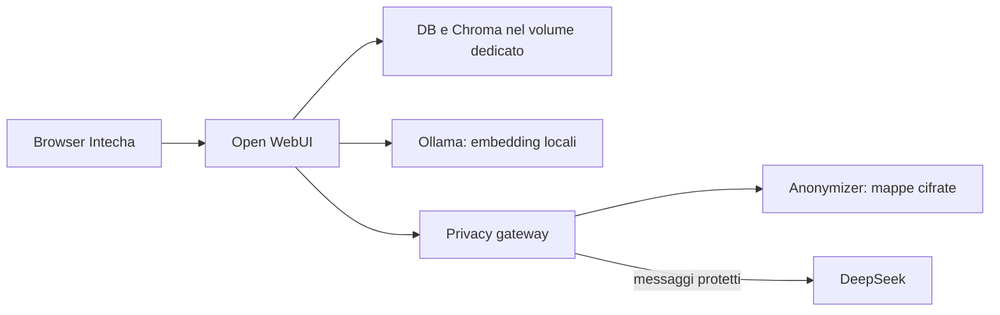

# Architettura corrente — Intecha Chat

Dal 30 ottobre 2026 il runtime scelto è **Open WebUI con gateway Anonymizer**.
Il Dockerfile e il Compose predefiniti costruiscono e avviano questa architettura.

Open WebUI gestisce UI, identità, permessi, chat, documenti, retrieval e strumenti.
Il gateway gestisce l'uscita testuale verso DeepSeek, il contratto di protezione e
il ripristino. L'Anonymizer esistente mantiene chiave Fernet e archivio separati.
I dati originali restano nell'infrastruttura; non c'è un invio cloud senza protezione
come fallback. I falsi negativi del riconoscimento automatico restano possibili.

Fonti operative e dettagli:

- [Architettura, configurazione, migrazione e ripristino](OPENWEBUI.md).
- [Contratto e limiti del gateway](../services/privacy-gateway/README.md).
- [ADR 006 — scelta della nuova base](adr/006-openwebui-intecha.md).
- [Piano e stato del passaggio](plans/05-openwebui-migrazione.md).
- [Architettura del prodotto precedente](LEGACY_ARCHITECTURE.md).

Il backend FastAPI custom, il frontend React e le migrazioni Supabase rimangono
conservati come legacy. I dati vengono importati esplicitamente: non si riutilizzano
schema Supabase e indici Qdrant come se fossero compatibili con Open WebUI.
Il motore listini e le quote custom non sono automaticamente collegati alla nuova UI.
