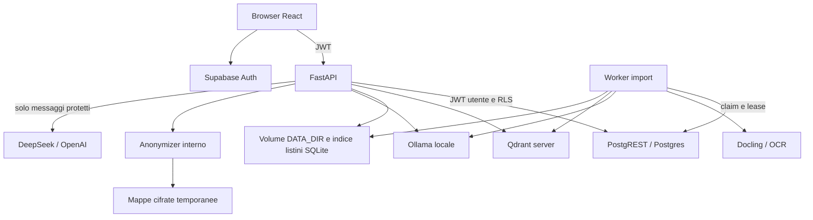

# Architettura attuale

Rilevazione del 30 ottobre 2026 sul commit `09467b4`. Fonte: codice e configurazioni
versionate. Topologia e parametri effettivi di produzione non verificati in questa attività.

## Quadro d'insieme

Il backend è un'applicazione FastAPI modulare con worker Python separato. Non c'è
un framework agentico generalista: l'orchestrazione DeepSeek è in `core/agentic.py`.
Il frontend è una SPA React; Supabase gestisce identità e database applicativo.

Anonymizer restituisce messaggi protetti al backend: non inoltra direttamente le
richieste ai provider. Il backend ripristina la risposta prima del salvataggio.

## Componenti e responsabilità

| Componente | Fonte | Responsabilità |
| --- | --- | --- |
| API | `backend/app/main.py`, `api/` | Auth, KB, chat, documenti, impostazioni e admin |
| IAM | `backend/app/auth.py`, migrazione IAM | JWT ES256/JWKS, profilo corrente, permessi SQL e RLS |
| Import | `backend/app/worker.py`, `core/import_jobs.py` | Coda persistente, lease, retry e pubblicazione |
| Estrazione | `core/pdf_extraction.py`, `core/documents.py` | Docling, OCR, sezioni, tabelle, pagine e chunk |
| Retrieval | `core/chat.py`, `lexical.py`, `hierarchical.py` | Dense+sparse, RRF, MMR, sezioni e vicini |
| Agente | `core/agentic.py` | Ricerca, lettura sezioni, versioni e listini, con budget |
| Listini | `core/price_lists.py` | Indice SQLite derivato, valori Decimal, filtri e confronti |
| Privacy | `core/privacy.py`, `services/anonymizer/` | Protezione obbligatoria per chat esterne e mappe temporanee |
| UI | `frontend/src` | Chat, fonti, PDF, KB, account e amministrazione |

## Modello dati e proprietà dei dati

| Archivio | Entità | Ruolo |
| --- | --- | --- |
| Supabase Auth | `auth.users`, sessioni | Identità e autenticazione |
| Postgres | `app_profiles` | Ruolo corrente, stato account e quote |
| Postgres | `knowledge_bases`, `knowledge_members` | Proprietario, visibilità e assegnazioni KB |
| Postgres | `documents`, `import_jobs` | Documenti pubblicati e ciclo di import |
| Postgres | `conversations`, `messages` | Chat personali, messaggi e fonti salvate |
| Postgres | `app_models`, `model_members` | Catalogo, accessi e tariffe configurate |
| Postgres | `usage_events`, `admin_audit` | Consumi, prenotazioni e modifiche amministrative |
| Qdrant | Collezione `kb_<uuid_con_underscore>`; legacy `documents` | Vettori e payload dei chunk con provenienza |
| DATA_DIR | `imports/`, `uploads/`, `extracted/` | PDF pendenti/originali ed estrazioni strutturate |
| DATA_DIR | `runtime_config.json`, prompt personalizzato | Configurazione persistente dell'app |
| SQLite derivato | `price_list_versions`, `price_list_entries` | Indice ricostruibile dai JSON strutturati |
| Volume Anonymizer | Mappe cifrate | Ripristino PII, temporaneo per richiesta e con TTL |

Relazioni principali: KB → documenti/importazioni/conversazioni; conversazione →
messaggi; utente → profilo, KB possedute, assegnazioni e conversazioni. La migrazione
IAM finale rende la cancellazione della KB a cascata anche sulle chat collegate.
Le chat non diventano pubbliche per l'admin. La revoca di accesso alla KB impedisce
la lettura delle chat correlate. Qdrant non è la fonte delle autorizzazioni.

PostgREST usa normalmente il JWT del chiamante; worker e operazioni amministrative
richiedono credenziali server. L'accesso privilegiato va mantenuto confinato.

## Importazione PDF

1. API verifica diritto editor/owner e limite file di 20 MiB; salva il PDF pendente.
2. Crea `import_jobs`; la richiesta HTTP non esegue la conversione completa.
3. Un worker acquisisce il lavoro atomicamente (`SKIP LOCKED`) e rinnova il lease.
4. Docling conserva struttura/tabelle e usa OCR secondo il controllo del testo nativo;
   `pypdf` resta un modo legacy selezionabile esplicitamente.
5. Genera chunk con titoli/provenienza, embedding locali e vettori lessicali; scrive
   Qdrant, PDF, JSON e indice listini. Pubblica infine la riga `documents`.
6. La chat interroga solo ID pubblicati e autorizzati; dati parziali restano invisibili.

Non c'è una transazione distribuita fra Postgres, filesystem e Qdrant: lease,
cleanup e pubblicazione finale gestiscono il recupero. Un solo worker è la
configurazione documentata. Dettagli: [IMPORT_WORKER.md](IMPORT_WORKER.md).

## Domanda e risposta: tre percorsi

L'API verifica sessione, KB, modello consentito e quota; carica la cronologia dal
server, ignorando quella inviata dal browser. La cronologia viene limitata a 12
messaggi e 16.000 caratteri.

1. **Listini riconosciuti:** query strutturata su documenti pubblicati, calcoli
   Decimal e risposta deterministica con fonti; nessuna generazione necessaria.
2. **DeepSeek agentico:** se abilitato e con KB, prima ricerca fino a `min(top_k, 6)`
   frammenti senza espansione automatica. Il modello può cercare di nuovo,
   `read_section`, trovare versioni e interrogare listini. Massimo 3 approfondimenti,
   6 tool call e 120 secondi configurati; i timeout locali restano separati.
3. **Percorso standard:** query semantica formata dalle ultime due domande e quella
   corrente; ramo lessicale con domanda corrente. Retrieval → MMR → espansione
   sezioni/vicini → generazione. Provider esterni protetti, Ollama locale.

**Valori da distinguere:** l'API ha `top_k=12`, ma `ChatPage.tsx` passa **5**.
Di conseguenza, dalla UI l'agente parte normalmente da 5 fonti, non sempre da 6.
Ogni ricerca considera almeno 24 candidati (`max(top_k*2,24)`). Soglia semantica
predefinita 0,3; i codici lessicali possono recuperare passaggi sotto quella soglia.

Le collezioni migrate fondono dense e sparse con RRF; le vecchie restano in
`semantic_legacy`. L'encoder lessicale è hashing di termini con TF logaritmica,
peso per identificativi e IDF Qdrant: **non è BM25 completo**.
MMR diversifica ma non sostituisce un reranker. Non c'è un reranker dedicato.
Espansione standard: 18.000 caratteri per sezione, 48.000 totali, un vicino per lato
senza struttura. Sono budget in caratteri, non token. L'agente legge le sezioni
solo quando richiede lo strumento. Il controllo citazioni agentico verifica gli ID,
non la verità di ogni affermazione. [Dettagli](AGENTIC_RAG.md).

## Mappa API

Contratti e schemi di dettaglio: router in `backend/app/api` e `/docs` dell'istanza.

| Prefisso | Operazioni principali |
| --- | --- |
| `/health` | Stato pubblico; `/health/qdrant` autenticato |
| `/api/knowledge` | CRUD KB, accessi, documenti, upload, retry import e PDF |
| `/api/directory` | Directory utenti per la condivisione |
| `/api/chat` | POST domanda, modello/KB, risposta, fonti e metadati ricerca |
| `/api/conversations` | Elenco, creazione, dettaglio, eliminazione e messaggi |
| `/api/settings/models` | Configurazione/catalogo chat ed embedding |
| `/api/settings/prompt` | Lettura e gestione prompt |
| `/api/account` | Profilo, password e consumi personali |
| `/api/admin` | Utenti, modelli, KB, quote, audit e utilizzi |

Autenticazione dell'app: Supabase email/password; niente signup pubblico/OAuth
implementato nel flusso descritto. Authentik può essere un ulteriore filtro al
proxy se configurato sul server, ma non sostituisce il JWT e l'IAM Supabase.

## Deploy e persistenza

- `docker-compose.yml`: frontend Vite separato (5173), API (8000), Qdrant server,
  Anonymizer e worker. Supabase e Ollama sono dipendenze esterne al Compose.
- `Dockerfile` radice: build multi-stage Node 22 + Python 3.12; FastAPI serve anche
  la SPA compilata in `/app/static`. È il percorso applicativo singola immagine.
  Il worker deve essere una risorsa separata dalla stessa revisione.
- `backend/Dockerfile`: API/worker CPU; `backend/Dockerfile.cuda` e override GPU
  supportano una variante. Disponibilità CUDA e vantaggi vanno misurati sull'host.
- Coolify è il target descritto nei runbook. Reti, alias, volumi, immagini effettive,
  health check e presenza di Authentik restano da verificare live.
- Compose monta `DATA_DIR=/app/data`; i runbook server usano anche `/data`:
  allineare variabile e mount fra API e worker. Mai affidarsi al path senza verifica.
- Il worker rifiuta Qdrant embedded (`QDRANT_LOCAL_PATH`); usare Qdrant server.
- `runtime_config.json` può prevalere sui default d'ambiente per provider e modelli.
  Cambio embedding con indici popolati richiede migrazione/reindicizzazione esplicita.
- Le migrazioni SQL sono quattro, ordinate in [AGENTS.md](../AGENTS.md).
  Nessun runner automatico applicativo è presente.

Backup coerente: Postgres, Qdrant, DATA_DIR inclusi import pendenti/estrazioni e
SQLite, volume Anonymizer e chiave originale custodita separatamente. SQLite a
caldo richiede API backup; una copia indipendente di database e WAL non basta.
Testare un ripristino isolato, non solo l'esistenza del backup.

## Hermes/MCP e sincronizzazione vault

Assenti nel repository. Il vault Anonymizer contiene mappe cifrate, non note Obsidian.
Un'integrazione futura richiede una decisione e un contratto dedicati; non è una
dipendenza del chatbot attuale.

## Valutazione dello stato

La struttura applicativa copre IAM, import persistenti, fonti, retrieval ibrido,
listini e ricerca agentica. La qualità RAG non ha qui una baseline comparativa
ripetibile sui PDF reali. I test presenti coprono soprattutto correttezza dei
moduli, permessi e protocolli con dipendenze simulate; non dimostrano qualità live.

Punti da verificare o migliorare:

- Versioni API/worker e quattro migrazioni effettivamente distribuite; collezioni
  realmente ibride e documenti reimportati con la struttura attuale.
- Prefissi query/documento e modello esatto Nomic; il client attuale non li aggiunge.
- Score RRF usati da MMR insieme a penalità coseno: scale diverse da calibrare.
- Ricerca iniziale con cronologia concatenata; espansione agentica facoltativa.
- Mancanza di reranker e strumenti generali per ricerca testuale/lettura per intervalli.
- Limiti output: 1.500 token standard esterno; fino a 3.000 per chiamata agentica,
  entro budget cumulativo. Riassunti lunghi ed elenchi completi possono risentirne.
- Ticket storici su timeout Docling e immagini API/worker diverse; stato live ignoto.
- Alcuni runbook conservano istruzioni precedenti (ruoli e embedded): leggere questo
  quadro e le sezioni IAM/worker aggiornate prima di applicarle.

Il confronto con Open WebUI è un'indicazione di lavoro, non un benchmark completato.
Sequenza proposta: [misurare](plans/01-valutazione-rag.md),
[ranking](plans/02-embedding-ranking.md), [lettura](plans/03-lettura-documenti.md),
[collaudo operativo](plans/04-collaudo-operativo.md).
