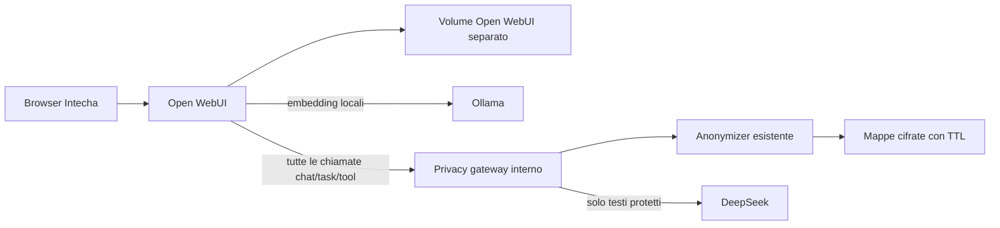

# Intecha su Open WebUI

Scelta e prima migrazione: 30 ottobre 2026. Base upstream v0.12.5,
commit `f7ac7ee10962ddec0017f5c29b6740d9b9c5faca`, immagine fissata per digest.
Il deployment usa Compose sulla rete Docker `coolify`; non è ancora una nuova
risorsa registrata nel pannello Coolify. Le sorgenti sono nel branch
`codex/openwebui-intecha` del repository chatbot-rag.

## Architettura



Il gateway ripristina la risposta prima di restituirla a WebUI; ogni chiamata
successiva riceve di nuovo protezione. Il provider key è esclusivamente nel gateway;
WebUI riceve una chiave interna distinta. La chiave Fernet resta solo nell'Anonymizer.
Il gateway non pubblica porte host, non inoltra redirect e non supporta endpoint
cloud generici. Contratto completo: [README gateway](../services/privacy-gateway/README.md).

## Configurazione iniziale

- Chat DeepSeek Flash, function calling nativo e strumenti documentali.
- Nessuna connessione chat Ollama o diretta dell'utente; Ollama serve gli embedding.
- Embedding `nomic-embed-text`, prefissi query/documento distinti e indice nuovo.
- Retrieval ibrido BM25+vettori; 12 candidati configurati, compressione fino a 8.
  Non è stato aggiunto un cross-encoder dedicato: resta una possibile ottimizzazione.
- Chroma e database applicativo Open WebUI nel volume `intecha-openwebui-data`.
  Nessun riutilizzo diretto del vecchio Qdrant/Supabase come schema Open WebUI.
- Estrazione locale del PDF tramite motore predefinito upstream; i JSON Docling
  storici sono conservati nel backup, non reimportati automaticamente come schema.
- Registrazione pubblica disabilitata, accesso amministrativo alle chat e export
  amministrativo disabilitati, lingua iniziale italiana.
- Chiamate titolo/query/strumenti verso la stessa connessione protetta.
- Web search, immagini, connessioni dirette e condivisione community disabilitate.
  Non abilitare altre uscite cloud senza estendere il contratto di protezione.
- Configurazione globale da ambiente (`ENABLE_PERSISTENT_CONFIG=false`): modifiche
  operative si applicano al Compose, non solo dalla UI.

## Personalizzazione del marchio

`Dockerfile` estende l'immagine upstream e `brand.py` modifica nome/asset compilati,
la favicon e la schermata iniziale. Il codice RAG upstream resta quello della release.
Lo script fallisce se il blocco di branding upstream cambia; le risorse compresse
vecchie vengono rimosse. Copyright e licenza originali rimangono nell'immagine.

Il proprietario ha confermato il limite <=50 persone con accesso diretto in ogni
periodo mobile di 30 giorni. L'eccezione è documentata in
[NOTICE](../deploy/openwebui/NOTICE.md), con la
[licenza originale](../deploy/openwebui/UPSTREAM_LICENSE). Un fork non elimina questi
obblighi. Valutare autorizzazione/licenza o marchio originale prima di superare il limite.

## Dati migrati e limiti di equivalenza

Inventario iniziale: 2 account amministratori attivi, 2 KB, 4 PDF, 14 conversazioni,
40 messaggi. Gli hash bcrypt vengono copiati senza conoscere le password; le sessioni
precedenti non sono trasferite e serve accedere di nuovo. L'import crea una mappa
ID utente/KB/file; i vecchi ID conversazione vengono conservati.

Proprietari e visibilità KB sono mappati ai grant Open WebUI; chat personali e testo
sono conservati. I riferimenti `[Fonte N]` delle chat importate diventano `[N]` e sono
collegati ai nuovi file. La verifica confronta hash PDF, hash password, proprietari,
contenuti e conteggi. Il migratore si ferma per utenti non-admin, inattivi o con reset
obbligatorio: questi casi richiedono una politica IAM separata, senza attribuzioni implicite.

Non vengono convertiti in funzioni native: quote/contabilizzazione Supabase, audit,
risposte deterministiche dei listini e indice prezzi. I dati storici e i sorgenti
sono preservati. Il motore listini richiederà un tool dedicato se si vuole riesporlo.
L'IAM Open WebUI non equivale alla vecchia RLS Postgres. Non c'è sincronizzazione
bidirezionale fra vecchia e nuova app dopo il passaggio.

## Procedura server e segreti

Percorso verificato: `/home/mulo/intecha-chat`, con permessi 0700; `.env` 0600.
Il file contiene token esistenti e segreti nuovi; non copiarlo in Git o in chat.
Anonymizer e Ollama restano servizi esistenti, senza sostituzione dei volumi.

Gli script in `deploy/openwebui/` hanno controlli specifici per questo server:

1. `server-bootstrap.py`: prepara l'ambiente dal container legacy senza stampare segreti.
2. `export-legacy.py`: snapshot privato di metadati/chat, hash login e PDF/estrazioni.
3. `migrate.py`: dentro WebUI con `PYTHONPATH=/app/backend`, stadi users/documents/chats.
   Richiede il backup in `/tmp/intecha-migration`; `state.json` rende riprendibili gli stadi.
4. `verify-migration.py`: controlli locali senza chiamate LLM esterne.
5. `builtin-smoke.py`: verifica gli schemi pubblici dei builtin con flag di produzione e chat salvata, senza dati utente.
6. `synthetic-smoke.py`: WebUI temporaneo isolato, dati solo fittizi e rimozione del fixture.

I file `auth.json` e `legacy.json` sono sensibili: restano solo sul server con accesso
ristretto. Copiare `state.json` fuori dal container prima di ricrearlo. Non avviare
una nuova esportazione sopra uno snapshot esistente.

## Avvio, dominio e ritorno al precedente

```sh
# Anteprima privata, servizi esterni già pronti
docker compose up -d --build
# Pubblicazione dopo verifica dati e test
docker compose -f docker-compose.yml -f deploy/openwebui/docker-compose.route.yml up -d
```

L'override assegna priorità 1000 al router `chatbot.intecha.dev`, porta interna 8080.
La configurazione segue il proxy HTTP interno esistente; HTTPS pubblico è gestito
dall'infrastruttura già presente. WebUI rimane anche su localhost:3080 per diagnosi.
Non riattivare il legacy per nuove scritture in parallelo.

Ripristino: avviare il container applicativo legacy e il suo worker dalla revisione
registrata nel manifest; fermare il nuovo servizio webui o ricrearlo senza override
router per tornare al vecchio routing. Non cancellare volumi. Dopo nuove chat sulla
nuova app, il ritorno al legacy non le sincronizza: esportarle prima. Per ripartire
con il nuovo servizio mantenere stesso volume e WEBUI_SECRET_KEY.

`docker-compose.legacy.yml` e `Dockerfile.legacy` conservano la configurazione precedente;
non lanciare quel Compose sul server pensando che ricrei automaticamente le risorse
Coolify con i nomi originali. Il rollback live usa i container/volumi registrati.

## Verifiche

- Suite gateway con provider/Anonymizer simulati: 37 test passati.
- Chiamate reali DeepSeek con dati sintetici: protezione/ripristino e SSE verificati.
- Istanza WebUI isolata: login, modelli, upload, KB, retrieval e risposta corretta con
  citazione su documento INTECHA-42 fittizio; nessun segnaposto esposto.
- Migrazione: verificati 2 hash password, 4 hash PDF, 2 KB e grant, 14 chat, 40 messaggi;
  ricerca locale su entrambe le KB senza chiamate LLM esterne.
- Non è un benchmark comparativo di qualità né una garanzia sui falsi negativi PII.
- I collaudi che inviano estratti dei documenti reali a un provider richiedono
  autorizzazione specifica; una revisione automatica ha bloccato il primo tentativo.
  In assenza di autorizzazione, usare solo retrieval locale e fixture sintetici.
- Dominio attivato e verificato il 30 ottobre 2026; WebUI/gateway healthy e legacy fermo. Backup finale documentato in
  [fase 05](plans/05-openwebui-migrazione.md).
